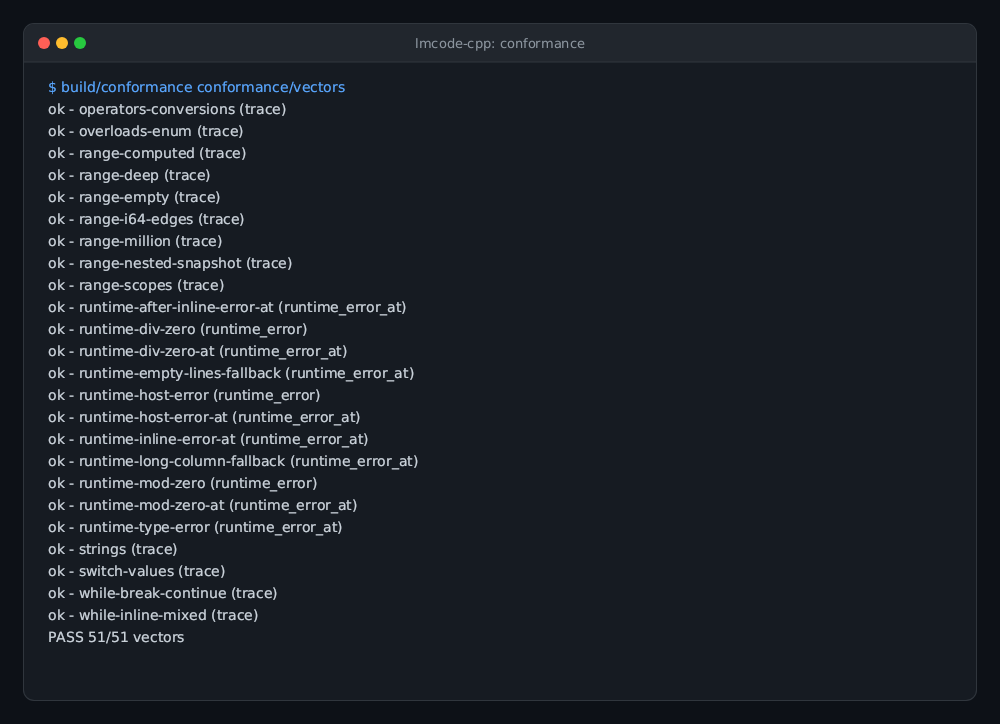
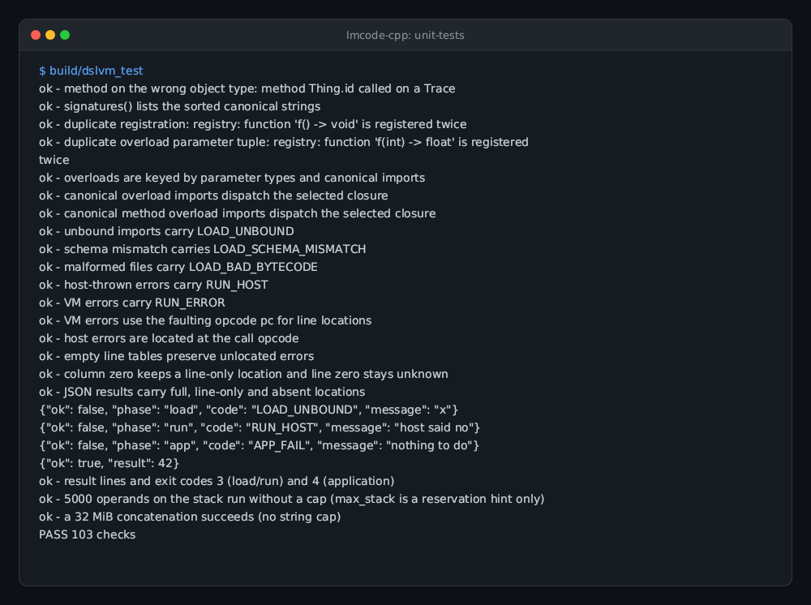
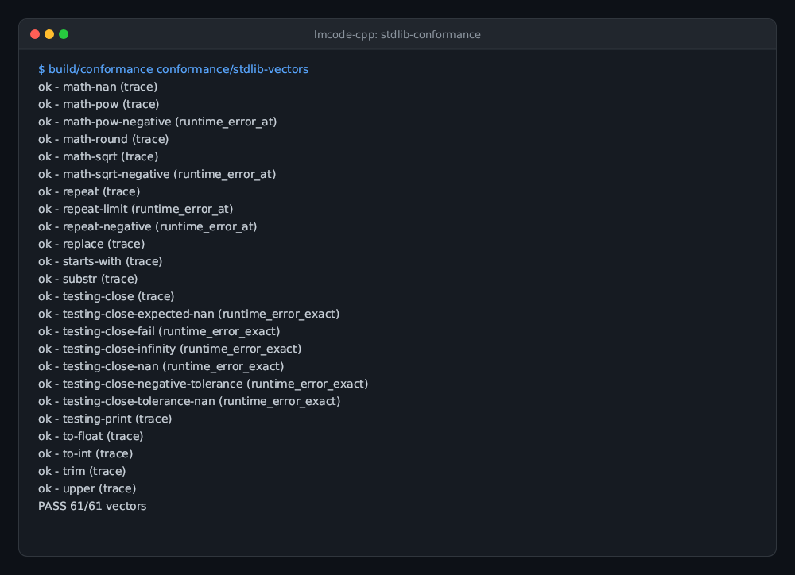
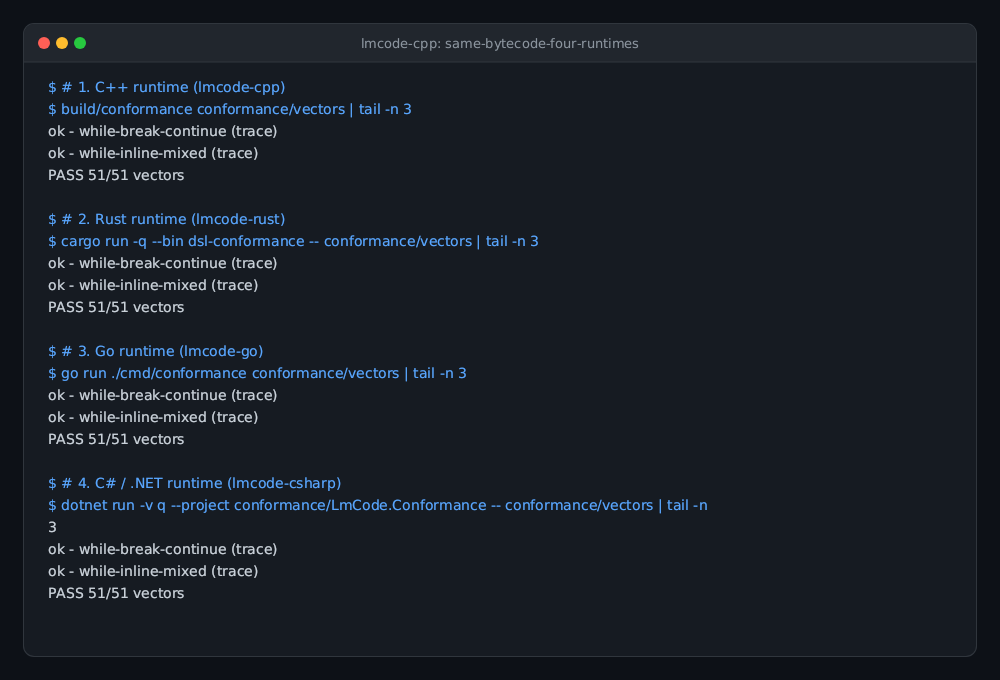

# lmcode-cpp

The C++ runtime for lmscript `_dsl_` bytecode: loader, verifier, VM and host registry in one header, `include/dslvm.hpp`.
C++17, standard library only, no dependencies. This repository is the single source of truth for the header; hosts vendor it
by pinned hash (see "Consuming it").

## Status

Experimental. The current runtime reads bytecode version 5 only; older and newer versions are refused. Use a matching
`lmscript` compiler from the published `@lmctl-ai/lmctl` npm package. The published compiler requires Node.js >=24.15.0.

## Build

The SDK is header-only. Include `include/dslvm.hpp` and compile a C++17 host; no library build or external dependency is needed.
See [Embedding it in twenty lines](#embedding-it-in-twenty-lines) for a minimal host.

## What it is

lmscript compiles a `_dsl_` block (a small strongly typed configuration language whose names come from a JSON schema) into a
portable bytecode file (`savedsl`). A host program written in C++ embeds this header, implements the schema's objects and
functions in a `dslvm::Registry`, loads the file with the exact schema bytes, and runs the chunk once per event with a
`dslvm::Context` of live host objects. The host owns the process, the objects and their lifetime; the chunk only calls what
the registry offers. lmscript never executes the DSL; this SDK never reads the schema's content, only its bytes (for the
SHA-256 binding).

## Gallery

| **Bytecode Conformance Suite** | **Unit Tests & Invariants** |
| --- | --- |
|  |  |
| All 51 core bytecode vectors pass across opcodes, types, error paths, and control flow.<br>`make conformance` | 103 unit tests verifying VM type invariants, line tables, and registry semantics.<br>`make test` |

| **Standard Library Conformance** | **Same Bytecode, Four Runtimes** |
| --- | --- |
|  |  |
| 118 catalog vectors covering collections, math, string, file, and optional testing.<br>`build/conformance conformance/stdlib-vectors` | Cross-language parity: C++, Rust, Go, and C# run the exact same bytecode.<br>`PASS 51/51 vectors across 4 runtimes` |

## Embedding it in twenty lines

```cpp
#include "dslvm.hpp"
struct Greeter { std::string last; };

int main(int argc, char** argv) {
  dslvm::Registry reg;
  reg.context("g", "Greeter");                                                       // the schema's context variable and its type
  reg.method("Greeter", "say", {"string"}, "void", [](void* self, dslvm::Args& a) { // Greeter.say(string) -> void, declared as in the schema
    static_cast<Greeter*>(self)->last = a[0].s; return dslvm::Value::none(); });
  reg.function("now", {}, "string", [](dslvm::Args&) { return dslvm::Value::string("2026-10-18"); });  // now() -> string
  if (argc > 3 && std::string(argv[3]) == "--dsl-signatures") { for (auto& s : reg.signatures()) std::cout << s << "\n"; return 0; }  // diffed against `lmscript --dsl-signatures`

  dslvm::Program program;
  try { program = dslvm::Program::load(dslvm::read_file(argv[1]), dslvm::read_file(argv[2]), reg); }  // bytecode, schema
  catch (const dslvm::Error& e) { std::cerr << "refused: " << e.what() << "\n"; return 3; }       // nothing ran

  Greeter greeter;
  dslvm::Context ctx; ctx.set("g", &greeter);
  try { program.run(ctx, reg); } catch (const dslvm::Error& e) { std::cerr << "dsl error: " << e.what() << "\n"; return 3; }
  std::cout << greeter.last << "\n";                                     // the host continues with what the chunk did
}
```

`Registry` is declared with the schema's types (parameter types and return type, as strings); a name may have several overloads with distinct parameter tuples, while registering the same parameter tuple twice is refused. `load()` resolves canonical import signatures (including parameter and return types), and refuses a file whose imports the registry does not provide, before anything runs. `reg.signatures()` lists the
sorted canonical strings, including the built-in standard. Compare them with `lmscript --dsl-signatures`
for the merged schema, or use `matches_schema_signatures(...)` with a host-only schema. That is a consistency
check, not a defense: by design the VM performs no comprehensive call-time argument or return checks; it still checks method receiver kinds and other defensive VM invariants. Bytecode is trusted like the host's
own code. `Value` carries `INT` (int64), `FLOAT` (binary64), `STR`, `BOOL` and `OBJ` (a host pointer plus the schema type name); a
void method returns `Value::none()`. Host code throws `dslvm::Error` to report a run-time failure.

**Result line and exit codes.** CLI hosts print exactly one JSON line on stdout through `dslvm::report_ok(json)`,
`dslvm::report_error("load"|"run", e)` (returns 3) or `dslvm::report_app_failure(message)` (returns 4) and exit with the returned
code; lmscript's own compile failures are exit 2. `Error::code` is `LOAD_BAD_BYTECODE`, `LOAD_SCHEMA_MISMATCH`, `LOAD_UNBOUND`,
`RUN_ERROR` (a VM error), `RUN_HOST` (thrown by a host closure) or `APP_FAIL`. When a non-empty line table maps the faulting
opcode, `Error` carries numeric `line`/`column` and prefixes the message with `dsl line N:C: `; the standard JSON result includes
those fields; a zero column means the line is known and only `line` is emitted. Empty line tables preserve the original message and omit the fields. Server hosts (lmweb) keep their own protocol.

## Versioning rule

`dslvm::VERSION` is the bytecode format version this SDK reads. The SDK version equals that number (currently 5) and the
loader refuses every other version: there is no backward compatibility. When the compiler's format changes, the compiler,
this header and every host move together. Version 5 includes structured `while` and `range` loops, lexical `break` and
`continue`, integer and floating-point math, typed imports, and line tables.

## What load() guarantees

Wrong magic, another version (v3/v4 included), a schema-hash mismatch, truncation, trailing bytes, unknown constant tags,
undecodable instructions, out-of-range constant/local/import/context indexes, calls whose import kind or arity differ, ordinary
jumps that miss an instruction start, go backwards outside a paired `LOOP_BACK` or cross a loop boundary, malformed or misnested
range/while loops, unknown
MATH function IDs, writes to
their read-only hidden locals, a missing HALT, and
context declarations or import signatures the registry does not provide (the message names the host's own signature for that
name) are refused with a message that names the problem. `run()` checks value kinds defensively and imposes no limits
(design decision): no stack cap, no locals cap, no string cap; `max_stack` from the file is a reservation hint.
Integer arithmetic is 64-bit two's complement and wraps; division and remainder by zero are the run-time errors.

## Test

    make test           # native runtime and optional string catalog tests
    make conformance    # 51 core runtime vectors and 77 standard catalog vectors
    make test-string-stdlib # stdlib/string.hpp unit cases and schema/registry/compiler signature parity

## Standard library catalog

`stdlib/` implements the built-in standard installed by every default registry. The canonical
`std/lmcode-std.schema.json` supplies declarations to the current compiler through the merge helper.
The individual fragments and group binders remain available for manual opted-out registries:

```cpp
#include "stdlib/string.hpp"
dslvm::Registry registry(dslvm::StdMode::Disabled);
dslvm::stdlib::register_string(registry);
```

Register once per registry, not once per chunk. Both chunks must have been compiled against the exact schema bytes supplied to their loads:

```cpp
const auto schema = dslvm::read_file("host.schema.json");
auto first = dslvm::Program::load(dslvm::read_file("first.dslb"), schema, registry);
auto second = dslvm::Program::load(dslvm::read_file("second.dslb"), schema, registry);
dslvm::Context context; // Set any host context objects here.
first.run(context, registry);
second.run(context, registry);
```

Copy the fragment's `functions` object into the host schema. `make test` runs the unit host and compares its sorted
`Registry::signatures()` against the current compiler's `--dsl-signatures` output for `tests/string.schema.json`. It uses
`$LMSCRIPT_BIN` when set; otherwise the check uses a compatible `lmscript` on PATH, or runs the published package with `npx` if the PATH command is too old. Set `LMSCRIPT_BIN` to select a specific CLI.
The parity test also checks the fixture against the shipped fragment and uses the executable selected by `BUILD`, including sanitizer builds.
The catalog header is compiled alone with `-std=c++17 -Wall -Wextra -Werror`.

| Function | Parameters → result | Meaning |
|---|---|---|
| `str_starts_with` | string, string → bool | Prefix test; empty prefix matches. |
| `str_ends_with` | string, string → bool | Suffix test; empty suffix matches. |
| `str_contains` | string, string → bool | Substring test; empty needle matches. |
| `str_lower` | string → string | ASCII lowercase. |
| `str_upper` | string → string | ASCII uppercase. |
| `str_substr` | string, int, int → string | Byte slice with clamping. |
| `str_len` | string → int | Byte length, including NUL bytes. |
| `str_match` | string, string → bool | Whole-string glob match; second argument is the pattern. |
| `str_find` | string, string → int | First byte offset, -1 if absent; empty needle returns 0. |
| `str_replace` | string, string, string → string | Replace non-overlapping matches. |
| `str_trim` | string → string | Trim ASCII whitespace at both ends. |
| `str_repeat` | string, int → string | Repeat count times; zero returns empty. |
| `str_to_int` | string → int | Parse signed 64-bit decimal, or return 0. |
| `str_is_int` | string → bool | Whether integer parsing succeeds. |
| `str_to_float` | string → float | Parse finite double, or return 0.0. |
| `str_is_float` | string → bool | Whether floating-point parsing succeeds. |

String operations use byte offsets, byte lengths, and byte matching; UTF-8 is not decoded. Embedded NUL bytes are preserved,
and NUL is not whitespace. In C++, construct NUL-containing values with an explicit-length `std::string`. `str_lower` and `str_upper` only map
ASCII letters. `str_substr(s,start,count)` clamps negative starts to zero and overlong counts to the end; negative counts or starts
beyond the end return empty. `str_find` returns `-1` when absent. `str_replace` replaces non-overlapping matches and leaves the
input unchanged for an empty search string. It preflights the result size before allocation and throws `dslvm::Error`
(code `RUN_HOST`, message `str_replace: result must be at most 67108864 bytes`) above 64 MiB, including no-op copies. `str_trim` removes ASCII space and bytes `0x09` through `0x0d`. Integer and float
 parsing validates a complete, in-range decimal token with at most one leading sign; integer conversion uses `std::from_chars`, while float conversion uses `strtod_l`/`_strtod_l` in a per-call C numeric locale.
Whitespace, embedded NULs, hexadecimal forms, overflow and unrepresentable floating-point underflow are invalid; `str_to_int`/`str_to_float` return zero on failure, and `str_is_int`/
`str_is_float` distinguish failure (float `nan`/infinity are invalid). `str_repeat` rejects negative counts and results above
64 MiB with `dslvm::Error` (code `RUN_HOST`, message
`str_repeat: count must be nonnegative and result at most 67108864 bytes`). An empty string with any nonnegative count returns empty. `str_match` supports `*` (including slash), `?`, byte classes/ranges, `[!class]`, and backslash escapes inside and outside classes.
A leading `]` in a class is literal; descending ranges match no bytes. An unterminated `[` and a trailing backslash are literal. It uses a
non-recursive matcher with O(1) auxiliary memory and a deterministic per-call limit of 2^27 work units.
Each matcher iteration, character-class entry scanned (a byte or range, including malformed classes), and trailing star skipped
consumes one unit. Attempting the next unit throws `dslvm::Error`, code `RUN_HOST`, message
`str_match: pattern exceeds the 2^27 work limit`; it does not return a false match. These catalog limits are host policy, not VM limits.

`conformance/vectors` is generated by the lmscript compiler's conformance generator
from small DSL programs that cover every opcode, type and error path: `NAME.dsl` (source), `NAME.dslb` (bytecode),
`NAME.expect` (line 1 `trace`, `runtime_error` or `load_error`, then the expected trace lines or error substring) and
`manifest.json`, whose `host` entry describes the stub a runtime must implement (context `t` records calls; `root`, `thing`,
`twice`, `half`, `yes`, `fail`). A line beginning `~ ` in an expected trace keeps its prefix exact and accepts a finite numeric
token within relative tolerance 1e-12, for platform libm results. Another runtime (e.g. a future Rust one) can implement the same stub and reads
the same files; nothing in the vectors is C++-specific.

## Consuming it

Hosts keep a verbatim copy at `cpp/dslvm.hpp` plus `sdk.lock` (SDK commit and the header's sha256) and `scripts/sync-sdk.sh`,
which copies the header from a sibling checkout `../lmcode-cpp` and rewrites the lock; each host's `test.sh` fails when the
vendored header's hash differs from the lock. Example hosts: lmcad (CAD/rendering), lmhtml (HTML tooling), lmor-dsl (OR-Tools).

## License

This project, including `include/dslvm.hpp` and the optional `stdlib/` catalog, is licensed under the MIT License. See [`LICENSE`](LICENSE). These are project-authored files and require no additional third-party notices.

## Sibling runtimes

The same bytecode v5 and the same conformance vectors are implemented by [lmcode-cpp](https://github.com/lmctl-ai/lmcode-cpp),
[lmcode-rust](https://github.com/lmctl-ai/lmcode-rust), [lmcode-go](https://github.com/lmctl-ai/lmcode-go) and
[lmcode-csharp](https://github.com/lmctl-ai/lmcode-csharp). Each is a library that turns an AOT executable into an lmscript host.

Standard catalog conformance fixtures and their portable byte-tracing host contract are in
[`conformance/stdlib-vectors`](conformance/stdlib-vectors/README.md).

`stdlib/collections.hpp` provides byte-string, int64 and binary64 lists plus insertion-ordered string maps. Default registries own their arena; native callbacks use `registry.std_collections().make_*` to return standard values valid for the run. `stdlib/testing.hpp` provides optional `print` and `assert_close`; hosts declare them in their own schema and explicitly call `register_testing(registry, optional_sink)`. `make test` checks all catalog behavior and compiler signature parity.

## Built-in lmcode std

Every `dslvm::Registry` now includes the 171-signature standard by default. `Registry(StdMode::Disabled)` opts out; `dslvm::register_std(registry)` enables it idempotently. `signatures()` includes std, `host_signatures()` excludes it, and `matches_schema_signatures(...)` accepts either host-only or already-merged declarations while still rejecting host drift. Collections belong to the registry and are cleared at entry and exit of each `Program::run`, including failures; native callbacks allocate through `registry.std_collections()`. Printing and assertions are outside std and require the optional testing catalog or host implementations.

`std/lmcode-std.schema.json` is the canonical versioned surface. Until the compiler injects it implicitly, `python3 scripts/merge-std.py host.schema.json effective.schema.json` generates the effective compile/load schema without copying std declarations into host sources. The helper also extracts host-only schemas and normalizes compiler signature lists. Vendor `include/dslvm.hpp` together with all `stdlib/*.hpp`; default registration has no external library dependency. Individual group headers and explicit binders remain supported for manual opted-out registries. Domain-specific types and stricter assertions remain host APIs.

`stdlib/file.hpp` supplies built-in `file_read`, `file_write`, `file_append`, `file_exists`, and `file_lines`: raw bytes, native paths, no newline translation. LF splitting preserves CR and a trailing empty field; failures report function, original path and OS reason.

The [generated std reference](docs/std.md) lists every built-in signature, its byte semantics, and errors.

## Complete teaching host and shared integration corpus

Start at [lmcode-cpp-sample](https://github.com/lmctl-ai/lmcode-cpp-sample) for a
small C++17 shop/ledger host and a ten-step embedding guide. Its vendored copy of
[`sample-suite/`](sample-suite/README.md) is shared by the C, C++, Rust, Go, C#,
Java, Kotlin and Scala samples. The canonical suite lives here: 63 programs plus
three loader mutations, exact stdout/exit fixtures, CLI protocol checks and an audit
of the original 72 std imports; v2 sample coverage is added with the new programs.

```sh
# With the C++ sample checked out beside this SDK:
make sample-suite
# Or run any host implementation against these exact bytes:
./sample-suite/run-suite.sh /path/to/host
```

Compiler/language changes must recompile and review this corpus, then run every
sample port. New std functions fail the import audit until covered. The C++
reference's expanded 66 outputs also matched an independent Go SDK host exactly.

### C embedding API

C hosts include [`include/lmcode_c.h`](include/lmcode_c.h) and link the small
C++ implementation [`src/lmcode_c.cpp`](src/lmcode_c.cpp). Opaque registry,
context and program handles expose the same VM, typed function-pointer callbacks,
default standard catalog, optional testing sink, and located errors. Strings are
length-counted; object pointers remain application-owned. Keep the registry alive
until all programs using it are destroyed. See the header for buffer lifetimes.

```sh
make test-c-api   # compiles tests/lmcode_c_api_test.c as C11, then links C++17
```

The C caller test executes overloads, object/context callbacks, host errors with
source locations, load/schema errors, print bytes including NUL/LF, and exact JSON
reporting. The C API is part of `make test`, not an independent interpreter.
